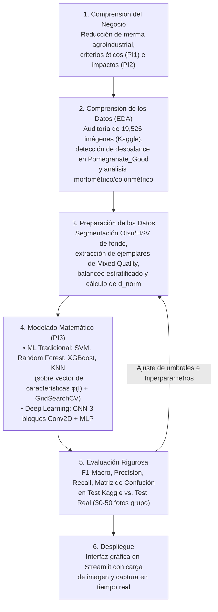

# Arquitectura del Sistema y Metodología CRISP-DM Adaptada

## 1. Flujo Metodológico CRISP-DM Personalizado

---

## 2. Formulación Matemática Preliminar (Indicador PI3)

Sea $I \in [0, 255]^{H \times W \times 3}$ una imagen digital en espacio RGB de alto $H$ y ancho $W$.

### 2.1. Segmentación y Estimación de Tamaño Relativo ($d_{\text{norm}}$)
Mediante conversión a espacio HSV y umbralización automática de Otsu sobre saturación y luminancia complementaria, se obtiene una máscara binaria del objeto $M \in \{0, 1\}^{H \times W}$ donde $M(u, v) = 1$ pertenece a la fruta. El área ocupada en píxeles es:

$$A_{\text{fruta}} = \sum_{u=1}^{H} \sum_{v=1}^{W} M(u, v)$$

El **diámetro equivalente en píxeles normalizados** ($d_{\text{norm}} \in [0, 1]$) se define como el diámetro de un círculo de igual área relativo a la dimensión geométrica de la imagen:

$$d_{\text{norm}}(I) = \sqrt{\frac{4 \cdot A_{\text{fruta}}}{\pi \cdot (H \cdot W)}}$$

A partir de los cuantiles empíricos $(q_{1/3}, q_{2/3})$ de $d_{\text{norm}}$ por tipo de fruta, se asigna la categoría de tamaño:
$$\hat{y}_{\text{size}} = \begin{cases} \text{Pequeño (Small)} & \text{si } d_{\text{norm}} < q_{1/3} \\ \text{Mediano (Medium)} & \text{si } q_{1/3} \le d_{\text{norm}} < q_{2/3} \\ \text{Grande (Large)} & \text{si } d_{\text{norm}} \ge q_{2/3} \end{cases}$$

### 2.2. Vector de Características $\phi(I)$ y Clasificación de Calidad
Para los modelos de Machine Learning tradicional, se define el extractor explícito $\phi: \mathbb{R}^{H \times W \times 3} \rightarrow \mathbb{R}^d$ compuesto por momentos estadísticos de color en RGB y HSV sobre la región activa $M(u,v)=1$, histogramas cromáticos normalizados, descriptores de textura (varianza del Laplaciano y gradientes de Sobel) y morfometría ($d_{\text{norm}}$, relación de aspecto, solidez).
